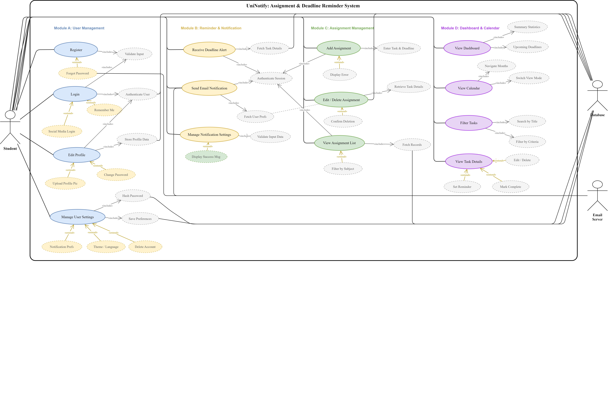
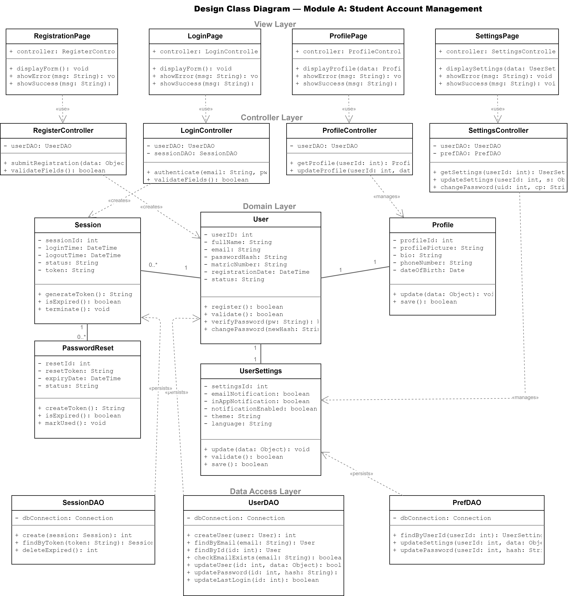
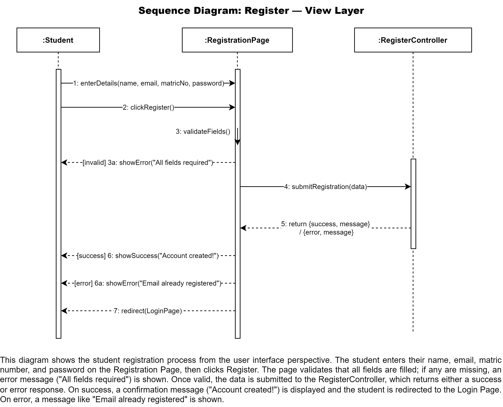
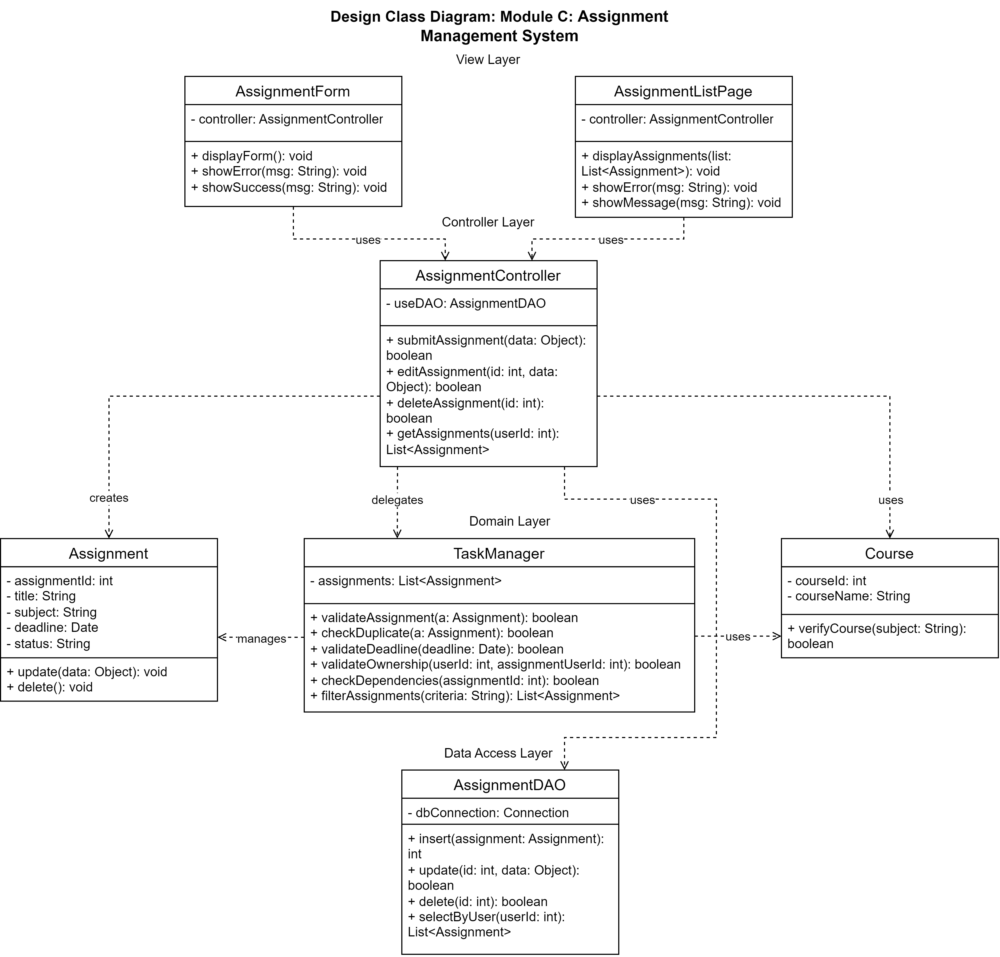
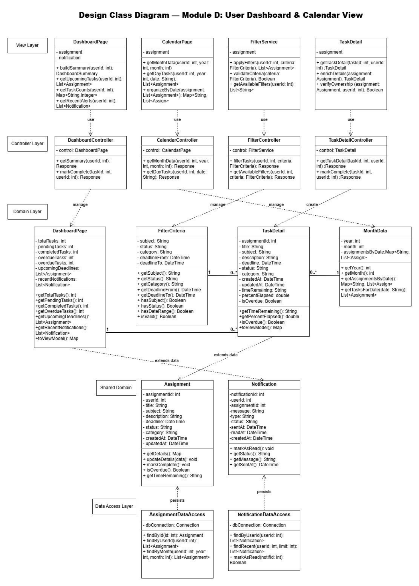

# Expanded CCA103 Design Narrative: Modules A to D

## Context and Scope Expansion
In CCA103 Systems Analysis and Design (Semester II, 2025/2026, Group 36), the team designed UniNotify: Assignment and Deadline Reminder System across Report 1 (System Analysis) and Report 2 (System Design and Implementation). Only Lim Chin Jiek and Gabriel Gan built the original CCA103 system, the remaining CKS222 members contribute through the process audit and scope expansion.

The original coursework focused mainly on a single-student task tracker. For CKS222, the scope is expanded into a fuller multi-role academic platform while keeping the original four modules: Module A (User Management System), Module B (Reminder and Notification), Module C (Assignment Management System), and Module D (User Dashboard and Calendar View).

## Module A Expansion: User Management System
In CCA103 Report 1 and Report 2, Module A covered Register, Login, Edit Profile, and Manage User Settings across the View, Controller, Domain, and DAO layers. Its domain model relied on User, Session, Profile, UserSettings, and PasswordReset entities supported by UserDAO, SessionDAO, and PrefDAO.

To support a full-scale university platform, Module A is expanded in three areas:

* **Role-Based Access Control (RBAC):** Access rules are enforced across three distinct user roles: students, lecturers, and admins. Students manage personal tasks and profiles, lecturers manage assigned courses and course tasks, and admins manage system accounts and course records.
* **Stricter Authentication and Session Security:** Password policies enforce salted password hashing, login attempt limits with temporary account lockouts, timed single-use password reset tokens, and short-lived session tokens with automatic expiry checks on every request.
* **Profile and Audit Handling:** User account state changes, failed logins, and role updates are recorded in system audit logs alongside validated profile and notification preference updates.

## Module B Expansion: Reminder and Notification
In CCA103 Report 1 and Report 2, Module B covered Receive Deadline Alerts, Manage Notification Settings and Send Email Notification through NotificationPage, SettingsPage and EmailPreviewPage in the View layer, NotificationController and EmailController in the Controller layer, Reminder, Notification, AlertSchedule, and UserPreference in the Domain layer and AlertDAO, NotificationDAO and PreferenceDAO in the Data Access layer.

To support a full-scale university platform, Module B is expanded in three areas:

* **Automated Scheduling and Trigger Rules:** AlertSchedule checks upcoming deadlines against each user's configured lead times (such as 7 days, 3 days, 24 hours and 1 hour) before due dates while skipping completed tasks (TC-B-U03). In Vialing's institutional context, this expands from personal reminders into intake-wide reminders for incomplete student documents.
* **Multi-Channel Dispatch and Preferences:** Delivery expands from basic in-app alerts and email (SendGrid) to coordinated dispatch across email, SMS (Twilio), and push notifications (Firebase Cloud Messaging), governed by UserPreference settings (emailEnabled, inAppEnabled and leadTimeDays).
* **Failure Retry and Audit Logging:** When an external email or SMS gateway goes down, the Notification Engine logs the failure, sets the alert deliveryStatus to "RETRY" without marking the user as notified (mirroring TC-B-U09) and records every delivery attempt in the Notifications table for audit tracking. 

## Module C Expansion: Assignment Management System
In CCA103 Report 1 and Report 2, Module C handled Add Assignment, Edit/Delete Assignment, and View Assignment List through AssignmentForm and AssignmentListPage in the View layer, AssignmentController in the Controller layer, Assignment, Course, and TaskManager in the Domain layer, and AssignmentDAO in the Data Access layer.

For a fuller multi-role system, Module C is expanded in three areas:

* **Course Ownership and Role Rules:** Assignments are linked to verified courses and enrolments. Lecturers create, update, or remove official course assignments, while students track enrolled course tasks, add personal study tasks, and filter lists by course, status, or urgency.
* **Stricter Validation and Duplicate Checks:** TaskManager enforces future-only deadlines, valid course links, ownership checks before edits or deletions, and duplicate checks matching title, course, and deadline.
* **Cross-Module Data Integration:** Saved assignment deadlines feed Module B directly to trigger scheduled email and in-app reminders, and supply live task counts and due dates to Module D dashboard and calendar views.

## Module D Expansion: User Dashboard and Calendar View
In CCA103 Report 1 and Report 2, Module D covered View Dashboard, View Calendar, Filter Tasks and View Task Details through DashboardPage, CalendarPage, FilterService and TaskDetail in the View layer, DashboardController, CalendarController, FilterController and TaskDetailController in the Controller layer, DashboardPage, FilterCriteria, TaskDetail and MonthData in the Domain layer, Assignment and Notification in the shared domain, and AssignmentDataAccess and NotificationDataAccess in the Data Access layer.

For a multi-role platform serving a whole intake, Module D is expanded in three areas:

* **Role-scoped dashboards:** In CCA103 the dashboard summarised one student's own tasks. The expanded dashboard summary is scoped by role rather than by a single user id: a student sees personal and enrolled-course deadlines, a lecturer sees submissions outstanding across the courses they own, and an administrator sees intake-wide counts for documents still missing, mirroring the incomplete-document panel Vialing publishes on its own admissions dashboard. The scope is resolved from the RBAC rules defined in Module A, so the query filters by enrolment or course ownership instead of trusting an identifier supplied by the browser.
* **Read models over Modules B and C, never copies:** The dashboard and calendar display deadlines that belong to Module C and delivery state that belongs to Module B, so they read those records through AssignmentDataAccess and NotificationDataAccess rather than maintaining their own copies. This is the concrete fix for the duplicated-data-entry waste (W2): a deadline cached in a dashboard table drifts from the assignment it describes, and the user then sees two different dates for the same task.
* **Bounded queries for institutional-scale calendars:** CCA103 loaded a single month for a single student. A month view at institutional scale spans many courses and thousands of rows, so the month query becomes an indexed range scan on the due date, list views paginate instead of loading every match, and the dashboard summary is computed on read from the canonical records rather than recomputed and persisted on each page load. That keeps the view inside the response-time target set in Task 3 instead of degrading as the intake grows.

